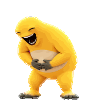
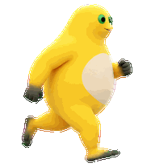
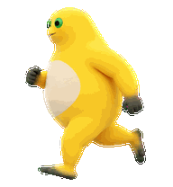
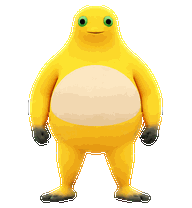
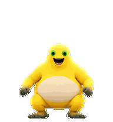
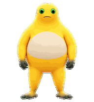
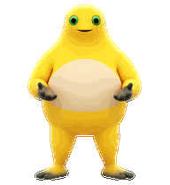
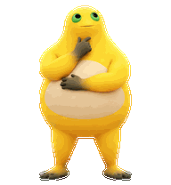
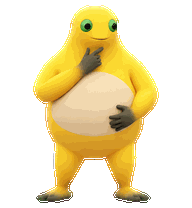
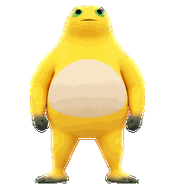

# Codex 奶龙宠物 · Codex Nai Long Pet

面向 Codex 宠物的非官方奶龙（Nai Long）动画素材项目：始终折腰、双手捧腹大笑。包含透明动画精灵图、九种状态、十六个视线方向，以及可本地运行的预览和导出工具。

An unofficial Nai Long animated companion for Codex Pets, with a continuous bent-forward belly laugh. This repository includes the transparent sprite atlas, nine animation states, sixteen gaze directions, and portable preview/export tools.


## 动作介绍

当前版本包含 **9 组状态动画 + 16 个视线方向姿态**。下面的用途描述对应素材的设计语义；具体什么时候切换状态，由使用它的客户端决定。帧数与循环时长来自 `assets/manifest.json`，预览保持相同节奏。

### 1. 折腰捧腹大笑 · `idle`

默认陪伴动作。奶龙始终向前折腰，双手捂住肚子，眯眼张嘴大笑。肩膀、头部和肚子围绕这个固定姿势轻微起伏，循环中不突然站直，也不反复做大幅鞠躬。

**6 帧，约 1.10 秒一轮。** 这一版把原先的大幅折腰切换改成小幅笑动，减少相邻画面的跳变。



### 2. 向右跑 · `running-right`

身体和脸朝向屏幕右侧，双腿交替迈步，配合手臂与身体的跑步姿势。适合表现向右移动时的步态；动画帧本身位于固定格子中，屏幕上的实际位移由客户端控制。

**8 帧，约 1.06 秒一轮。**



### 3. 向左跑 · `running-left`

身体和脸朝向屏幕左侧，保持与向右跑一致的步伐节奏。由批准的右跑帧逐帧镜像得到，保留时间顺序，用于向左移动时的步态。

**8 帧，约 1.06 秒一轮。**



### 4. 挥手打招呼 · `waving`

面向观看者，抬起一只手做招呼动作，再逐渐放低。另一只手和双脚保持稳定，表情友好，适合作为欢迎或引起注意的手势。

**4 帧，约 0.70 秒一轮。**



### 5. 开心跳跃 · `jumping`

动作依次为下蹲蓄力、起跳、空中展开手脚、下降和下蹲落地。用实际的上下位置变化表现腾空，最后回到原来的地面高度，适合庆祝或活泼互动。

**5 帧，约 0.84 秒一轮。**



### 6. 失落与受挫 · `failed`

从较正常的站姿逐渐垂下眼皮、低头、放松肩膀，再恢复一些精神。通过表情和身体姿态表达“遇到困难了”，适合失败、受阻或取消等状态的视觉反馈。

**8 帧，约 1.22 秒一轮。**



### 7. 等待回应 · `waiting`

双手在身体两侧摊开，配合歪头、看向观看者和轻微眨眼，形成“接下来怎么办”的询问感。适合表达等待输入、批准、帮助或选择。

**6 帧，约 1.01 秒一轮。**



### 8. 思考与工作 · `running`

双脚站稳，一只手靠近下巴，另一只手放在身前，配合头部倾斜和专注的眼神变化。这里的 `running` 表示任务正在进行，动作内容是思考、处理或专注工作；向左、向右移动的跑步动作分别由另外两组素材提供。

**6 帧，约 0.82 秒一轮。**



### 9. 检查与审阅 · `review`

手靠近下巴，身体微微前倾，视线向下或侧移，并通过眨眼和头部变化表现仔细观察。适合表达检查结果、核对细节或审阅已完成的内容。

**6 帧，约 1.03 秒一轮。** 与思考动作相比，这组更偏向“看一看、核对一下”。



### 10. 看向十六个方向 · `look`

这部分是 **16 个供客户端选择的定向姿态**。脚、下半身和肚皮保持稳定，头部、脸部与绿色眼睛自然转向目标方向。视线姿态采用站姿；上面的默认大笑动画则始终保持折腰捧腹。

以观看者的屏幕为坐标，角度从上方的 000° 开始，顺时针每次增加 22.5°。

| 角度 | 方向 | 姿态表现 |
| --- | --- | --- |
| 000° | 上 | 抬头，脸和眼睛朝上。 |
| 022.5° | 上偏右 | 保持抬头，轻微向屏幕右侧转。 |
| 045° | 右上 | 头部和视线同时指向右上方。 |
| 067.5° | 右偏上 | 主要朝右，保留轻微向上的角度。 |
| 090° | 右 | 脸和眼睛朝屏幕右侧。 |
| 112.5° | 右偏下 | 朝右的同时，头部略微下俯。 |
| 135° | 右下 | 头部和视线指向右下方。 |
| 157.5° | 下偏右 | 更明显地低头，并保留向右的朝向。 |
| 180° | 下 | 向前低头，眼睛朝下。 |
| 202.5° | 下偏左 | 保持低头，轻微向屏幕左侧转。 |
| 225° | 左下 | 头部和视线同时指向左下方。 |
| 247.5° | 左偏下 | 主要朝左，保留轻微下俯。 |
| 270° | 左 | 脸和眼睛朝屏幕左侧。 |
| 292.5° | 左偏上 | 朝左的同时，略微抬头。 |
| 315° | 左上 | 头部和视线指向左上方。 |
| 337.5° | 上偏左 | 更明显地抬头，并保留轻微向左的朝向。 |

下面的 GIF 为了展示全部姿态而顺序播放一圈，不代表宠物日常会自动转一整圈。



[查看全部状态的连续预览](previews/all-states.gif) · [查看动作与视线联系表](previews/contact-sheet.png)

## 文件

| 路径 | 内容 |
| --- | --- |
| `assets/spritesheet.png` | 最终透明 PNG，1536 × 2288，8 列 × 11 行 |
| `assets/manifest.json` | 每行状态、帧数和播放时长 |
| `preview/index.html` | 无需安装依赖的浏览器预览器 |
| `scripts/export_previews.py` | 从最终图集导出 GIF，检查帧数、透明空格和尺寸 |
| `previews/` | 大笑、全状态、视线循环、MP4 和联系表 |
| `source/idle-strip.png` | 六帧折腰大笑的原始生成动作条，洋红色抠像背景 |
| `source/prompt.md` | 角色和最终动作约束 |
| `validation/summary.json` | 最终成品的结构与质量检查摘要 |

## 预览

直接用浏览器打开 `preview/index.html`。也可以在仓库根目录运行：

```bash
python -m http.server 8000
```

然后访问 <http://localhost:8000/preview/>。播放器按图集逐帧显示，不做插帧，也不更改角色形状。

## 导出动画

```bash
python -m pip install -r requirements.txt
python scripts/export_previews.py
```

输出位于 `build/`。默认大笑循环使用 6 帧，时长为 `280, 110, 110, 140, 140, 320` 毫秒。改善流畅度靠小幅连续姿态，不是提高播放器帧率；此格式不等同于 24/60 fps 视频。

## 精灵图布局

每格 192 × 208 像素。前九行的有效帧数依次为 `6, 8, 8, 4, 5, 8, 6, 6, 6`，其余格透明。最后两行各有八个视线方向。

| 行 | 状态 | 有效帧数 |
| --- | --- | ---: |
| 0 | idle / 折腰捧腹大笑 | 6 |
| 1 | running-right / 向右跑 | 8 |
| 2 | running-left / 向左跑 | 8 |
| 3 | waving / 挥手 | 4 |
| 4 | jumping / 跳跃 | 5 |
| 5 | failed / 失落反应 | 8 |
| 6 | waiting / 等待输入 | 6 |
| 7 | running / 思考工作 | 6 |
| 8 | review / 检查结果 | 6 |
| 9 | look / 000° → 157.5° | 8 |
| 10 | look / 180° → 337.5° | 8 |

视线按顺时针排列，000° 为上、090° 为屏幕右、180° 为下、270° 为屏幕左。

导入支持这一 v2 格式的 Pets 客户端时使用 `assets/spritesheet.png`，不要上传 GIF 或原始动作条。不同客户端支持的上传格式可能不同。若桌面宠物只显示静止帧，请检查系统的“动画效果／减少动态效果”设置。

## 制作说明

角色和姿态由 OpenAI ImageGen 根据提供的形象与视频参考生成，再经确定性提取、对齐、抠像和校验组装。最终循环保持折腰、双手贴腹、眯眼张嘴，仅做小幅肩腹抖动，不在循环中站直。

这些素材是生成并筛选后的成品；提示词不保证重新生成逐像素相同的图像。本仓库不包含原始参考视频、聊天记录、账户标识、临时下载链接，或 Pets 插件内部脚本。

## 许可证

[MIT](LICENSE)。第三方参考作品不包含在仓库中；许可证仅覆盖本项目提供的贡献，不授予第三方角色或参考作品的权利。见 [NOTICE](NOTICE)。
